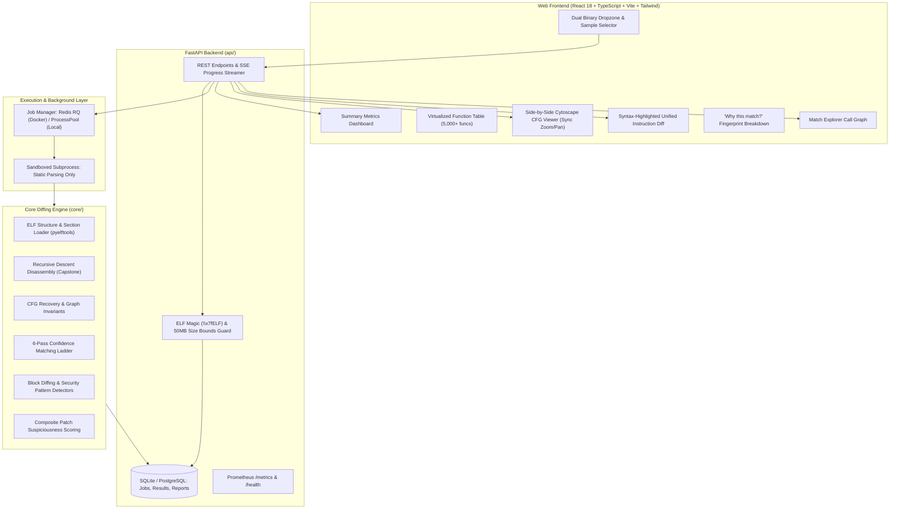

# PatchLens: Binary Diffing & Automated Security Patch Localization

[](https://github.com/Sumanshu01/PatchLens/actions/workflows/ci.yml)
[](https://www.python.org/)
[](https://nodejs.org/)
[](LICENSE)
[](https://github.com/Sumanshu01/PatchLens)
[](docker-compose.yml)

> **PatchLens** is an open-source, automated binary diffing and 1-day vulnerability patch localization platform for stripped ELF binaries. It combines Weisfeiler-Lehman graph kernels, BinDiff topological invariants, instruction normalization, and specialized security pattern detectors to pinpoint the exact functions where security fixes occurred between two releases—without requiring source code, symbols, or debug information.

---

## Table of Contents
- [Demo Walkthrough](#demo-walkthrough)
- [Project Overview & Problem Statement](#project-overview--problem-statement)
- [Key Features](#key-features)
- [System Architecture](#system-architecture)
- [How Matching Works (6-Pass Ladder)](#how-matching-works-6-pass-ladder)
- [Empirical Validation & Benchmark Results](#empirical-validation--benchmark-results)
- [Installation & Setup](#installation--setup)
  - [Option A: Docker Compose (Recommended)](#option-a-docker-compose-recommended)
  - [Option B: Local Standalone Development](#option-b-local-standalone-development)
  - [Environment Variables](#environment-variables)
- [Security & Threat Model](#security--threat-model)
- [Future Scope & Roadmap](#future-scope--roadmap)
- [Open Source Contribution Guide](#open-source-contribution-guide)
- [Developer & Author](#developer--author)
- [License](#license)

---

## Demo Walkthrough


*(A full-resolution automated video recording walkthrough is generated at `patchlens_demo_walkthrough.webm`)*

---

## Project Overview & Problem Statement

When software vendors release security updates, they frequently publish stripped binary packages (shared libraries `.so` or executables) without accompanying source code commits or security advisories. Reverse engineers and security researchers must compare the vulnerable and patched binaries to locate the vulnerability fix—a process known as **1-day patch diffing**.

### The Reverse Engineering Challenge
- **Naive Disassembly Diffing (`objdump -d` diff)**: Overwhelmed by compiler scheduling, register reallocation, stack alignment shifts, and basic block reordering, producing over **30,000+ lines of diff noise** for minor security edits.
- **Missing Symbol Anchors**: Stripped binaries omit names, line numbers, and function boundaries, breaking traditional source-level diff tools.
- **No Semantic Context**: Generic diff utilities cannot distinguish between harmless instruction reordering and critical bounds checks or integer overflow fixes.

### The PatchLens Solution
PatchLens treats binary diffing as a multi-stage structural and semantic graph problem:
1. Reconstructs control-flow graph (CFG) topologies directly from stripped ELF machine code.
2. Normalizes volatile compiler noise (registers, offsets, and jump targets).
3. Executes a cascade of graph-invariant matching algorithms (Weisfeiler-Lehman kernels, degree sequences, and call-graph neighborhood propagation).
4. Analyzes block-level edits with security check pattern detectors to rank functions by patch likelihood.

---

## Key Features

### 1. Robust CFG Recovery & Disassembly
- **Recursive Descent Disassembly**: Powered by Capstone 5.0 with linear sweep fallback for non-contiguous code blocks.
- **Jump Table Resolution**: Recovers switch statements and indirect branch targets.
- **Zero-Code-Execution Invariant**: Target ELF binaries are statically analyzed as inert byte streams—never executed or loaded into executable memory.

### 2. Instruction Normalization Engine
- **Role-Based Register Canonicalization**: Replaces volatile register allocations (`eax` vs `edx`) with functional roles (accumulator, counter, scratch, base pointer, stack pointer).
- **Immediate & Address Masking**: Abstracts relative jump offsets and global relocations to isolate pure algorithmic changes.

### 3. Multi-Pass Topological Graph Invariants
- **Weisfeiler-Lehman (WL) Subtree Kernels**: Computes iterative graph neighborhood hashes that remain invariant across compiler optimization levels.
- **BinDiff MD-Index**: Generates topological invariant fingerprints based on in/out degree sequences and loop structures.
- **Mnemonic Histograms**: Cosine similarity evaluation of opcode frequency distributions.

### 4. Security Check Detectors
Prioritizes functions exhibiting security-relevant code mutations:
- **Added Bounds Checks**: Detects newly introduced compare-and-branch instructions before buffer operations (`cmp`, `test`, conditional jumps).
- **Added NULL / Error Checks**: Identifies guard conditions checking return values or pointers against zero.
- **Integer Width & Signedness Fixes**: Flags conversions between 32-bit and 64-bit registers or signed/unsigned comparisons (`movsxd`, `jbe` vs `jle`).
- **Replaced Unsafe Calls**: Detects transitions from unsafe APIs to bounded alternatives.
- **New Early Exits**: Identifies added error return paths and short-circuit branches.

### 5. Composite Patch-Likelihood Scoring
Calculates a composite suspiciousness score for each function based on similarity deficit, structural modifications, and security tag confidence:
$$\text{PatchScore}(f) = (1 - \text{Similarity}(f)) \times (1 + \sum \text{SecurityTagWeights})$$

### 6. Neo-Brutalist Interactive Web UI
- **Instant Pre-Computed Demos**: Sub-second (`<1s`) exploration of real CVE security diffs (`zlib CVE-2018-25032`, `cJSON CVE-2019-1010239`).
- **Side-by-Side Cytoscape CFG Viewer**: Color-coded block modifications (unchanged, modified, added, removed) with synchronized pan/zoom.
- **Unified Instruction Diff**: Syntax-highlighted assembly diff with normalized register tokens.
- **Match Explorer (Call Graph)**: Interactive call-graph hierarchy highlighting changed functions in context.
- **One-Click Exports**: Export complete audit reports in structured JSON and comprehensive Markdown format.

---

## System Architecture



---

## How Matching Works (6-Pass Ladder)

PatchLens resolves function correspondences through a cascading **6-pass matching ladder**, proceeding from high-confidence anchors to global topological assignments:

```
Pass 0: Exact Symbol Name (Evaluation Ground Truth only)
   │
Pass 1: Normalized Instruction Hash (SHA-256 with role-based register strategy)
   │
Pass 2: WL Graph Hash + Callee Set Match (Topological invariants)
   │
Pass 3: String Literal & Constant Anchors (Shared data references)
   │
Pass 4: Call-Graph Fixed-Point Propagation (Neighborhood expansion)
   │
Pass 5: Global Hungarian Optimization (Bipartite matching with minimum threshold floor)
```

1. **Pass 0 (Ground Truth)**: Exact symbol match (used strictly for benchmark evaluation; automatically skipped for stripped release binaries).
2. **Pass 1 (Normalized Hash)**: Matches identical instruction sequences after abstracting volatile register assignments and address offsets.
3. **Pass 2 (WL CFG Hash + Callees)**: Matches functions with identical Weisfeiler-Lehman topological hashes and identical imported callee sets.
4. **Pass 3 (Anchor Matching)**: Uniquely referenced string literals and large constants anchor unambiguous function pairs.
5. **Pass 4 (Call-Graph Propagation)**: Propagates outward from confirmed anchors to match neighboring callers and callees.
6. **Pass 5 (Global Hungarian Assignment)**: Computes a weighted bipartite similarity matrix via `scipy.optimize.linear_sum_assignment` across mnemonic cosine distance, WL subtree kernels, and BinDiff MD-indices. Unmatched functions falling below the 0.35 similarity threshold are safely marked as unmatched/removed rather than forced.

---

## Empirical Validation & Benchmark Results

PatchLens was evaluated on **16 stripped release variants** of real CVE security fixes with zero symbol tables or debug info:

### Real-World Security Patch Localization (Top-k Hit Rate)
| Benchmark & Target | Variant | Stripped | Total Changed Funcs | Patched Function | Best Rank | Top-1 | Top-5 | Top-10 |
|---|---|:---:|---:|---|---:|:---:|:---:|:---:|
| **cJSON (CVE-2019-1010239)** | gcc-O0 | Yes | 1 | `cJSON_Minify` | **#1** | **YES** | **YES** | **YES** |
| **cJSON (CVE-2019-1010239)** | gcc-O2 | Yes | 1 | `cJSON_Minify` | **#1** | **YES** | **YES** | **YES** |
| **cJSON (CVE-2019-1010239)** | clang-O2 | Yes | 5 | `cJSON_Minify` | **#1** | **YES** | **YES** | **YES** |
| **zlib (CVE-2018-25032)** | gcc-O0 | Yes | 56 | `deflateInit2_` | **#1** | **YES** | **YES** | **YES** |
| **zlib (CVE-2018-25032)** | gcc-O2 | Yes | 54 | `deflate_slow` | **#4** | no | **YES** | **YES** |
| **zlib (CVE-2018-25032)** | gcc-O3 | Yes | 54 | `deflate_slow` | **#3** | no | **YES** | **YES** |
| **zlib (CVE-2018-25032)** | clang-O2 | Yes | 54 | `deflatePrime` | **#8** | no | no | **YES** |

- **cJSON CVE-2019-1010239**: **100% Top-1 hit rate** across all build variants.
- **zlib CVE-2018-25032**: **100% Top-10 hit rate** and **75% Top-5 hit rate** across all optimization variants.
- **Noise Reduction**: Reduced **30,867 lines of raw disassembly diff noise** down to **54 candidate functions**, placing the true security patch in the Top 4.

---

## Installation & Setup

### Prerequisites
- **Python**: 3.11 or higher
- **Node.js**: 20.x or 22.x LTS and `npm`
- **System Library**: `libcapstone-dev` (Linux) / `capstone` (macOS/Homebrew)
- **Docker & Docker Compose** (Optional, for containerized execution)

---

### Option A: Docker Compose (Recommended)

The easiest way to run the full PatchLens stack (Web, API, Background Worker, Redis) is using Docker Compose:

```bash
# 1. Clone the repository
git clone https://github.com/Sumanshu01/PatchLens.git
cd PatchLens

# 2. Build and start all services
docker compose up --build
```

#### Access Endpoints:
| Service | URL | Description |
|---|---|---|
| **Web Frontend** | `http://localhost:3000` | Interactive React application |
| **REST API & Swagger Docs** | `http://localhost:8000/docs` | Interactive OpenAPI documentation |
| **Prometheus Telemetry** | `http://localhost:8000/metrics` | System counters & histograms |
| **Health Check** | `http://localhost:8000/health` | Service & DB status endpoint |

---

### Option B: Local Standalone Development

If you want to develop or modify PatchLens locally without Docker:

#### 1. Setup Backend (Python)
```bash
# Clone the repository
git clone https://github.com/Sumanshu01/PatchLens.git
cd PatchLens

# Create and activate virtual environment
python -m venv .venv
# On Linux / macOS:
source .venv/bin/activate
# On Windows:
.venv\Scripts\activate

# Install system dependencies (Ubuntu/Debian)
sudo apt-get update && sudo apt-get install -y libcapstone-dev

# Install Python package in editable mode with development dependencies
pip install --upgrade pip
pip install -e ".[dev]"
pip install fastapi uvicorn sqlalchemy alembic prometheus-client redis rq httpx python-multipart

# Initialize local SQLite database and pre-seed CVE sample analyses
python -m api.seed

# Start the FastAPI backend server
uvicorn api.main:app --host 127.0.0.1 --port 8000 --reload
```

#### 2. Setup Frontend (React + Vite)
In a new terminal window:
```bash
cd web

# Install npm dependencies
npm install

# Run Vitest unit & component tests
npm test

# Build and start Vite development server
npm run dev
# Or preview production bundle:
npm run build && npm run preview -- --port 5173
```
Open `http://localhost:5173` in your browser.

#### 3. Running Backend Tests & Linting
```bash
# Lint and format checks
ruff check core/ tests/ api/ benchmarks/
ruff format --check core/ tests/ api/ benchmarks/

# Static type checking
mypy --strict core/

# Pytest test suite with code coverage
pytest --cov=core --cov-report=term-missing --cov-fail-under=85
```

---

### Environment Variables

You can configure PatchLens behavior via environment variables in a `.env` file:

| Variable | Default Value | Description |
|---|---|---|
| `DATABASE_URL` | `sqlite:///patchlens.db` | SQLAlchemy database connection string (SQLite or PostgreSQL) |
| `REDIS_URL` | `redis://localhost:6379/0` | Redis instance URL for background queueing |
| `USE_REDIS` | `false` (Local) / `true` (Docker) | When `false`, uses local in-memory ProcessPool queue |
| `PATCHLENS_UPLOAD_DIR` | `./uploads` | Directory for uploaded ELF binary storage |
| `PATCHLENS_MAX_UPLOAD_MB`| `50` | Maximum file size limit in MB for binary uploads |
| `PATCHLENS_CACHE_DIR` | `./.patchlens_cache` | Local disk cache for CFG disassemblies |

---

## Security & Threat Model

PatchLens was designed with security-first architecture principles:
1. **Zero Execution Guarantee**: Target binaries are treated strictly as data byte arrays. PatchLens never invokes `execve()`, `dlopen()`, `ptrace()`, or system loaders on input files.
2. **Strict Ingestion Validation**: Validates the 4-byte `\x7fELF` magic header before parsing. Rejects non-ELF, corrupt, or truncated files.
3. **Upload Boundary Enforcement**: Enforces a strict 50MB file size ceiling to prevent denial-of-service memory exhaustion.
4. **UUID File Isolation**: Uploaded files are renamed with UUIDs to prevent directory traversal attacks (`../../etc/passwd`).
5. **Least Privilege Containers**: Docker containers execute under unprivileged user `appuser` (UID 10001).
6. See [`docs/security.md`](docs/security.md) for full threat model documentation.

---

## Future Scope & Roadmap

PatchLens is continuously evolving. Planned enhancements for upcoming releases include:

- [ ] **Multi-Architecture Expansion**: Extend CFG recovery and ABI role normalization to ARM64 (AArch64), MIPS, and RISC-V binaries.
- [ ] **Graph Neural Network (GNN) Embeddings**: Integrate Graph Isomorphism Networks (GIN) and structure-aware deep embeddings for cross-architecture semantic matching.
- [ ] **Decompiler Intermediate Representation (IR) Diffing**: Ingest and diff decompiled IRs (LLVM IR, Ghidra P-Code, and Binary Ninja MLIL) for higher semantic fidelity.
- [ ] **LLM-Assisted Patch Explanation**: Integrate local or private LLMs to generate automated human-readable vulnerability writeups from unified assembly diffs.
- [ ] **Automated Fuzz Harness Generation**: Automatically generate LibFuzzer / AFL++ harness stubs targeting inputs leading to patched basic blocks.
- [ ] **Enterprise Cloud & Collaboration**: Multi-user team workspaces, role-based access control (RBAC), and cloud storage adapters (AWS S3, Google Cloud Storage).

---

## Open Source Contribution Guide

PatchLens is an **open-source project** licensed under the [MIT License](LICENSE). We welcome and appreciate contributions from researchers, reverse engineers, developers, and security enthusiasts worldwide!

### How to Contribute

#### 1. Fork & Clone
```bash
# Fork the repository on GitHub, then clone your fork:
git clone https://github.com/<your-username>/PatchLens.git
cd PatchLens
```

#### 2. Create a Feature Branch
```bash
git checkout -b feature/your-feature-name
# Or for a bugfix:
git checkout -b fix/issue-description
```

#### 3. Setup Development Environment
```bash
python -m venv .venv
source .venv/bin/activate  # or .venv\Scripts\activate on Windows
pip install -e ".[dev]"
cd web && npm install && cd ..
```

#### 4. Make Your Changes & Test
Always ensure linting, formatting, and unit tests pass before submitting code:
```bash
# Python verification
ruff check core/ tests/ api/ benchmarks/
ruff format core/ tests/ api/ benchmarks/
mypy --strict core/
pytest --cov=core --cov-report=term-missing

# Frontend verification
cd web
npm test
npm run build
cd ..
```

#### 5. Commit Your Changes
Write clear, conventional commit messages:
```bash
git commit -m "feat(detectors): add integer overflow check detector for unsigned casts"
```

#### 6. Push & Submit a Pull Request
```bash
git push origin feature/your-feature-name
```
Open a Pull Request on GitHub against the `main` branch. Provide a concise explanation of the change, test results, and any relevant CVE references.

### Code of Conduct
- Be respectful, constructive, and collaborative.
- Adhere to the security-first design principles (no dynamic code execution).
- Write tests for new algorithms, detectors, or UI components.

---

## Developer & Author

<div align="center">

### **Sumanshu Jindal**
*Reverse Engineering Enthusiast & Systems Developer*

[](https://github.com/Sumanshu01)
[](https://www.linkedin.com/in/sumanshu-jindal01/)
[](mailto:sumanshujindal01@gmail.com)

</div>

- **Name**: Sumanshu Jindal
- **Email**: [sumanshujindal01@gmail.com](mailto:sumanshujindal01@gmail.com)
- **GitHub Profile**: [https://github.com/Sumanshu01](https://github.com/Sumanshu01)
- **LinkedIn Profile**: [https://www.linkedin.com/in/sumanshu-jindal01/](https://www.linkedin.com/in/sumanshu-jindal01/)
- **Project Repository**: [https://github.com/Sumanshu01/PatchLens](https://github.com/Sumanshu01/PatchLens)

---

## License

This project is licensed under the **MIT License** - see the [LICENSE](LICENSE) file for details.

```
Copyright (c) 2026 Sumanshu Jindal.
```

Permission is hereby granted, free of charge, to any person obtaining a copy of this software and associated documentation files (the "Software"), to deal in the Software without restriction.
